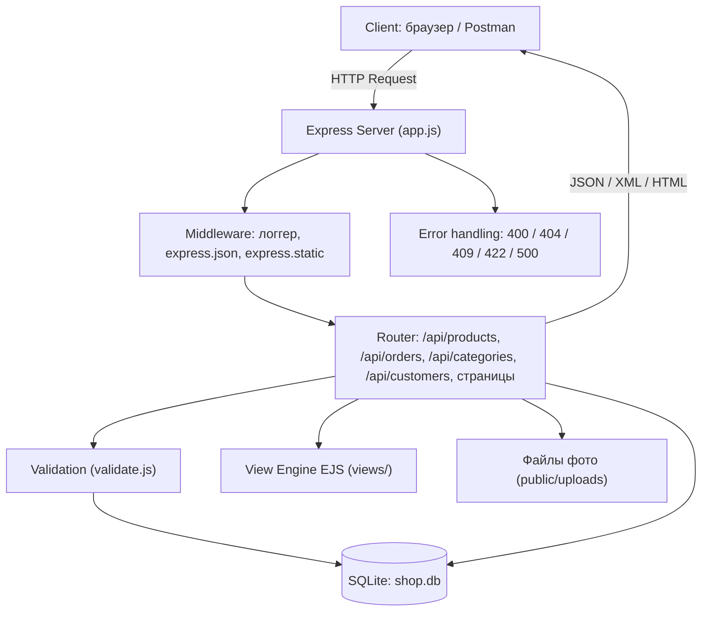
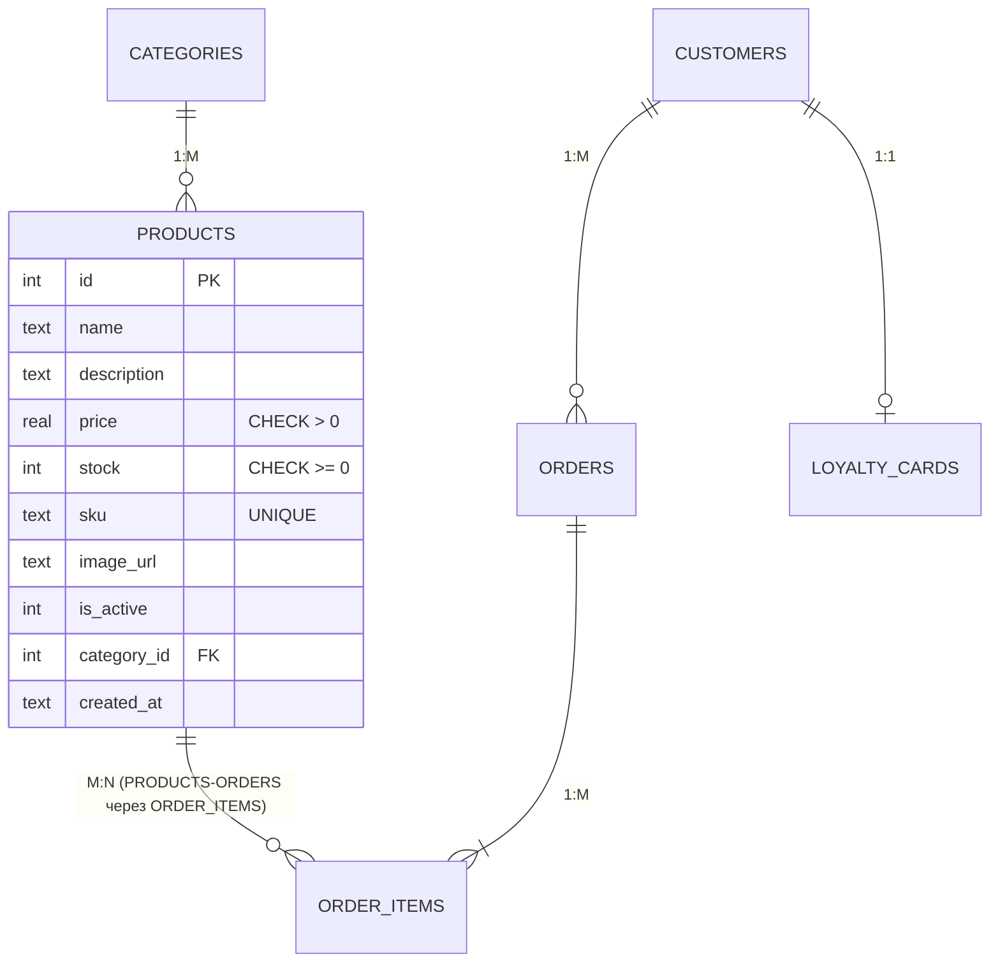

# Интернет-магазин (СӨЖ №1)

Учебный проект: Node.js + Express + SQLite + EJS. Оформление в оранжево-зелёных тонах, меню в левой панели, фото к товарам.

## Запуск
```
npm install
npm start
```
Открыть http://localhost:3000 (база `shop.db` создаётся сама, с тестовыми данными).

## Где какая тема из главы 4 (metanit.com)
| Тема | Где в проекте |
|---|---|
| 4.1 Начало работы | `app.js`: express(), app.get, app.listen |
| 4.2 Middleware | `app.js`: логгер в server.log, middleware для "/api" |
| 4.12 Отправка ответа | send, sendFile, sendStatus, status().send, json (`app.js`, `routes/*`) |
| 4.4 Статические файлы | `app.js`: express.static("public"), `public/` |
| 4.3 Маршрутизация | `app.js`: "/abo?ut", "/sho+p", регулярное выражение /^\/p(\d+)$/ |
| 4.13 Переадресация | `app.js`: redirect, redirect(301); `routes/pages.js` после POST |
| 4.14 Query-параметры | `/?category=1&search=...`, `/api/products?maxPrice=...` |
| 4.5 POST и формы | `routes/pages.js`: express.urlencoded, форма `/products/create` |
| 4.15 Параметры маршрута | `/products/:id`, `/categories/:categoryId/products/:productId` |
| 4.16 Router | `routes/*.js`, подключение в `app.js` |
| 4.6 JSON и AJAX | `express.json()`, `public/script.js` (fetch), `/api/orders` |

Фото товаров: пакет multer (глава 10 metanit), файлы в `public/uploads/` (`upload.js`).

Дополнительно для требований СӨЖ: SQLite (`db.js`), EJS (`views/`), XML (`/api/products/:id/xml`),
валидация (`validate.js`), обработка ошибок (конец `app.js`).

## Endpoint'ы
| Method | URL | Статус |
|---|---|---|
| GET | /api/products (?category, ?search, ?maxPrice) | 200 |
| GET | /api/products/:id | 200 / 404 |
| GET | /api/products/:id/xml | 200 / 404 |
| POST | /api/products | 201 / 400 / 409 |
| PUT | /api/products/:id | 200 / 400 / 404 / 409 |
| DELETE | /api/products/:id | 204 / 404 / 409 |
| POST | /api/products/:id/photo (form-data, поле `photo`) | 200 / 400 / 404 |
| GET, POST | /api/categories | 200 / 201 / 400 / 409 |
| GET, POST | /api/customers | 200 / 201 / 400 / 409 |
| GET | /api/orders, /api/orders/:id | 200 / 404 |
| POST | /api/orders | 201 / 400 / 404 / 422 |
| PUT | /api/orders/:id/status | 200 / 404 / 422 |

Формат ошибок: `{ "error": "...", "details": [...] }`

Пример заказа: `POST /api/orders` с телом `{"customerId":1,"items":[{"productId":2,"quantity":3}]}`

Корзина хранится в браузере (массив в `public/script.js`), на сервер уходит готовый заказ.


## Архитектура


## ER-диаграмма


## Проверка требований СӨЖ №1
| № | Требование | Где выполнено |
|---|---|---|
| 1 | Архитектура клиент-сервер | диаграмма выше |
| 2 | HTTP, Request/Response | методы GET/POST/PUT/DELETE, статусы 200/201/204/400/404/409/422 |
| 3 | JSON | все `/api/...` |
| 4 | XML | `GET /api/products/:id/xml` |
| 5 | REST, URI | ресурсы products, categories, customers, orders |
| 6 | 4-5 endpoint | 15+ (таблица выше) |
| 7 | Express | `app.js`, `routes/` |
| 8 | View Engine, 2+ страницы | EJS: каталог, товар, форма, заказы |
| 9 | CRUD | товары: create, read, update, delete (API и страницы) |
| 10 | БД, 3+ связанные сущности, 7-8 атрибутов | 6 таблиц, у products 10 атрибутов; связи 1:1, 1:M, M:N |
| 11 | Валидация 3+ случая | пустые поля, неверный тип, дубликат sku/email, формат и размер фото |
| 12 | Обработка ошибок | единый формат `{error, details}`, 404-обработчик, обработчик ошибок |
| - | GitHub, диаграммы, таблица endpoint'ов, Postman | репозиторий вы создаёте сами; диаграммы и таблица здесь; `docs/shop.postman_collection.json` |
| - | Отчёт 4-5 страниц, скриншоты, демонстрация | делается отдельно |
